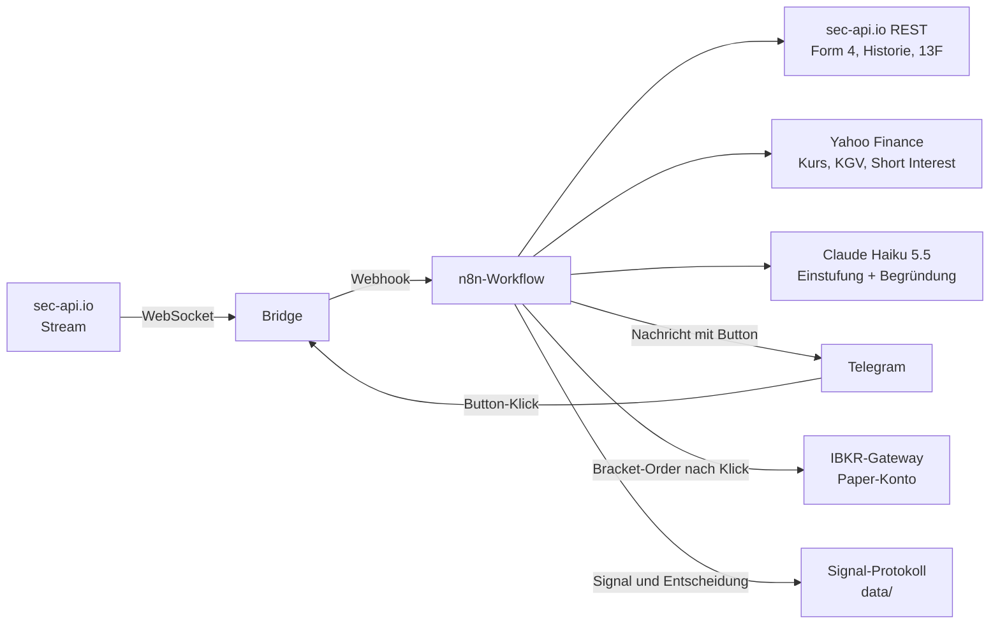

# Insider-Pipeline

Meldet Insiderkäufe aus SEC-Form-4-Filings in Echtzeit per Telegram, bewertet sie mit Claude und bereitet eine Bracket-Order für ein **Paper-Trading-Konto** bei Interactive Brokers vor. Die Order wird erst gesendet, wenn du in Telegram auf den Button tippst.

Alles läuft lokal in Docker: `docker compose up -d` startet n8n samt fertig importiertem Workflow, eine kleine Bridge und das IBKR-Gateway.

> Kein Anlageberatungswerkzeug. Die Einstufung des Modells ist eine Einschätzung auf Basis weniger Kennzahlen, und das Projekt ist ausschließlich für Paper-Trading gedacht.

## So funktioniert es



1. Die **Bridge** hält die WebSocket-Verbindung zum sec-api.io-Stream, lässt nur Form 4 durch und übergibt jedes Filing einmal an n8n.
2. Der **Workflow** lädt die Transaktionen des Filings und verwirft alles, was kein Offenmarktkauf ist (Transaction Code `P`, mehr als `MIN_SHARES` Aktien, Preis > 0).
3. Für jeden Kauf holt er die bisherigen Transaktionen dieses Insiders, die jüngsten 13F-Meldungen institutioneller Halter und Marktdaten.
4. Alle Kennzahlen (Volumen, Bestandsveränderung, Erfolgsquote früherer Käufe, Short Interest …) berechnet der Workflow selbst. **Claude** bekommt sie fertig vorgelegt und liefert nur die Einstufung `SCHWACH`/`MITTEL`/`STARK` mit Begründung. In der Nachricht stehen deshalb keine Zahlen, die das Modell erfunden haben könnte.
5. Du bekommst eine **Telegram-Nachricht** mit Analyse, Order-Vorschlag und zwei Buttons.
6. Erst ein Tipp auf **„Order ans Paper-Konto senden“** schickt die Bracket-Order (Kauf-Limit zum Insiderpreis, Take-Profit, Stop-Loss) an IBKR. Das Ergebnis kommt als zweite Nachricht.
7. Jedes Signal und jede Entscheidung landet im **Signal-Protokoll**. Damit lässt sich später prüfen, was die Signale tatsächlich wert waren (siehe [Signal-Protokoll und Backtest](#signal-protokoll-und-backtest)).

Fällt eine Datenquelle aus (Yahoo, 13F, Historie, Claude), kommt die Meldung trotzdem und nennt die Lücke. Bricht der Workflow ganz ab, meldet ein Error Trigger den Fehler per Telegram.

## Voraussetzungen

| Dienst | Wofür | Hinweis |
|---|---|---|
| [Docker Desktop](https://www.docker.com/) | führt alles aus | Node.js und `npx n8n` werden nicht gebraucht |
| [sec-api.io](https://sec-api.io/pricing) | Stream, Form 4, 13F | Tarif „Personal & Startups“; vor dem Buchen prüfen, dass er die Stream-API enthält |
| [Anthropic Console](https://console.anthropic.com/) | Claude | API-Key und etwas Prepaid-Guthaben |
| [Telegram](https://telegram.org/) | Benachrichtigung | Bot über @BotFather, eigene ID über @userinfobot |
| [Interactive Brokers](https://www.interactivebrokers.eu/) | Paper-Trading | Paper-Konto aktivieren; Kontonummer beginnt mit `D` (z. B. `DU1234567`) |

## Einrichtung

1. **Konfiguration anlegen**

   ```bash
   cp .env.example .env
   ```

   Trage in `.env` deine Schlüssel ein. Jede Variable ist dort erklärt. Für `BRIDGE_SECRET` genügt eine beliebige lange Zufallszeichenfolge, z. B. aus `openssl rand -hex 32`.

2. **Telegram vorbereiten:** Schreibe deinem Bot einmal `/start`. Vorher darf er dir keine Nachrichten senden.

3. **Starten**

   ```bash
   docker compose up -d
   ```

   Der erste Start lädt rund 4 GB an Images. Dabei legt ein Hilfscontainer (`n8n-init`) deine Schlüssel als verschlüsselte n8n-Credentials an, importiert den Workflow und veröffentlicht ihn.

4. **n8n öffnen:** <http://localhost:5678> – beim ersten Aufruf legst du ein lokales Admin-Konto an. Der Workflow „Insider Pipeline“ ist bereits vorhanden und steht auf „Published“.

5. **Prüfen, ob alles verbunden ist**

   ```bash
   docker compose logs bridge        # erwartet: "sec-api-Stream verbunden"
   docker compose logs ibkr-gateway  # erwartet: Sitzung "authenticated=True"
   ```

6. **Testlauf mit einem echten Filing** (siehe nächster Abschnitt).

## Testen

### Testlauf mit echten Daten

Statt auf den nächsten Insiderkauf im Stream zu warten, kannst du ein bereits veröffentlichtes Form 4 durch die Pipeline schicken:

```bash
# sucht den jüngsten Insiderkauf, der den Filter passieren würde
docker compose exec bridge node src/replay.js

# oder ein bestimmtes Filing
docker compose exec bridge node src/replay.js 0001234567-26-000123
```

Nach wenigen Sekunden sollte die Telegram-Nachricht eintreffen. Tippe auf den Button und kontrolliere in der IBKR-App (Paper-Modus), dass unter „Orders“ drei zusammenhängende Orders liegen. Jeden Schritt siehst du in n8n unter „Executions“.

Dieser Testlauf ruft die echten APIs auf. **Er ist der erste Lauf gegen die echten Dienste überhaupt** – siehe [Was noch nicht geprüft ist](#was-noch-nicht-geprüft-ist).

### Automatische Tests

Diese Tests brauchen keine Zugangsdaten und rufen keine echten APIs auf.

```bash
sh test/e2e/run.sh                          # End-to-End: echtes n8n, alle externen Dienste als Mock (ca. 4 Minuten)
node --test test/unit/workflow.test.js      # Logik der Code-Nodes (Node.js >= 22)
cd bridge && npm ci && npm test             # Bridge
cd research && npm test                     # Protokoll, Auswertung, Backtest
```

Der End-to-End-Test startet n8n mit genau dem Workflow aus diesem Repository und spielt zehn Szenarien durch, darunter die aus Teil 14 der ursprünglichen Anleitung: Kauf mit Analyse und Order nach Klick, Verkauf / Preis 0 / zu kleine Stückzahl (keine Meldung), Ausfall von Yahoo und Claude, unbekannter Kontrakt, verzögert indexiertes Filing, fremde und veraltete Klicks, von IBKR abgelehnte Order, der Fehlerpfad und Webhook-Aufrufe ohne Secret. Dabei wird auch geprüft, dass Signale und Entscheidungen im Protokoll ankommen; anschließend laufen Auswertung und Backtest gegen die Mock-Daten.

## Signal-Protokoll und Backtest

Ob die Signale etwas taugen, zeigt erst die Messung. Dafür gibt es zwei Werkzeuge, die dieselbe Rechenlogik verwenden: das Protokoll für die Signale, die du ab jetzt bekommst, und den Backtest für die Vergangenheit.

### Signal-Protokoll

Der Dienst `journal` schreibt jede Telegram-Meldung mit allen Kennzahlen, der Einstufung des Modells und dem Order-Vorschlag nach `data/signals.jsonl`, und jede Entscheidung (Order gesendet, abgelehnt, verworfen) nach `data/events.jsonl`. Beide Dateien werden nur erweitert, nie überschrieben.

```bash
docker compose run --rm research report
```

Die Auswertung holt aktuelle Kurse und zeigt, wie sich die gemeldeten Aktien seit dem Signal gegenüber dem Markt (SPY) entwickelt haben – nach 5, 20 und 60 Handelstagen, insgesamt, je Einstufung (STARK/MITTEL/SCHWACH) und je Entscheidung. Gerechnet wird mit Kauf zum Eröffnungskurs am ersten Handelstag nach dem Filing. Das Ergebnis liegt zusätzlich in `data/signals-report.md` und als Excel-taugliche Tabelle in `data/signals-report.csv`.

Aussagekräftig wird das erst mit der Zeit: Eine Haltedauer zählt erst, wenn sie abgelaufen ist, und Unterschiede zwischen den Einstufungen lassen sich erst ab etwa 100 Signalen je Gruppe von Zufall trennen.

### Backtest

```bash
docker compose run --rm research backtest --from 2024-01-01 --to 2025-06-30
```

Der Backtest lädt alle Insiderkäufe des Zeitraums von sec-api.io, wendet den Kauf-Filter des Workflows an und rechnet mit historischen Tageskursen von Yahoo nach. Der Bericht (`data/backtest/report.md`, Einzelwerte in `data/backtest/trades.csv`) beantwortet drei Fragen:

1. **Was ist das Signal wert?** Rendite und Überrendite gegenüber dem Markt nach 5, 20, 60 und 120 Handelstagen.
2. **Welche Order-Regel ist besser?** Die jetzige Regel des Workflows (Limit zum Insiderpreis mit Stop-Loss und Take-Profit) im Vergleich zu einem Kauf zur Eröffnung mit und ohne Stop-Loss/Take-Profit – jeweils mit Ausführungsquote und Rendite nach Kosten.
3. **Welche Signale sind besser?** Überrendite nach Rolle des Insiders, Kaufvolumen, Veränderung des Bestands, Cluster-Käufen, Routine- oder Gelegenheitskäufern, Handelbarkeit und Kursverlauf davor.

Wichtige Optionen (alle mit `docker compose run --rm research help`):

| Option | Standard | Bedeutung |
|---|---|---|
| `--from`, `--to` | letzte zwei Jahre | Zeitraum der Filings |
| `--stop-loss`, `--take-profit` | Werte aus `.env` | zum Durchspielen anderer Abstände |
| `--max-hold` | `60` | spätester Ausstieg in Handelstagen |
| `--cost-bps` | `10` | Kosten je Kauf und je Verkauf in Basispunkten |
| `--lookback-years` | `3` | Vorlauf, um Routinekäufer zu erkennen; `0` schaltet das ab |

Der erste Lauf braucht Geduld und Kontingent: Mit dem Vorlauf werden mehrere Jahre Insiderkäufe und Kurse für alle betroffenen Titel geladen, und die Abrufe zählen gegen dein Kontingent bei sec-api.io. Fang deshalb klein an, etwa mit `--from 2025-01-01 --to 2025-03-31 --lookback-years 0`. Alles Geladene liegt danach in `data/cache/`; ein zweiter Lauf mit anderen Parametern rechnet nur noch.

Was der Backtest nicht kann, steht am Ende jedes Berichts. Am wichtigsten: Unternehmen, die inzwischen von der Börse verschwunden sind, fehlen bei Yahoo – die Ergebnisse fallen dadurch zu gut aus. Und wer viele Merkmale durchprobiert, findet immer eine Gruppe, die zufällig gut aussieht; ein Merkmal verdient erst Vertrauen, wenn es sich in einem zweiten, getrennten Zeitraum bestätigt.

Unter Linux muss der Ordner `data/` dem Benutzer mit der ID 1000 gehören, sonst meldet `journal` beim Start, dass er nicht schreiben kann: `sudo chown -R 1000:1000 data`.

## Einstellungen

Alle Einstellungen stehen in `.env`. Nach einer Änderung: `docker compose up -d`.

| Variable | Standard | Bedeutung |
|---|---|---|
| `MIN_SHARES` | `1000` | Nur Käufe mit mehr Aktien werden gemeldet |
| `ORDER_BUDGET_USD` | `5000` | Ordergröße: Stückzahl = Budget / Limitpreis |
| `ORDER_QUANTITY` | leer | Feste Stückzahl; hat Vorrang vor dem Budget |
| `STOP_LOSS_PCT` | `8` | Abstand des Stop-Loss zum Limitpreis in Prozent |
| `TAKE_PROFIT_PCT` | `15` | Abstand des Take-Profit zum Limitpreis in Prozent |
| `ORDER_BUTTON_MAX_AGE_HOURS` | `24` | Danach ist der Order-Button wirkungslos |
| `ANTHROPIC_MODEL` | `claude-haiku-5-5` | Modell für die Einstufung |
| `COMPOSE_PROFILES` | `ibkr` | Leer lassen, wenn du ein eigenes IBKR-Gateway betreibst |

Den Prompt findest du in n8n im Node **Build_Prompt**, den Aufbau der Nachricht in **Build_Message**. Nach Änderungen in der Oberfläche auf „Publish“ klicken. `docker compose up -d` überschreibt einen vorhandenen Workflow nicht; mit `WORKFLOW_IMPORT=force docker compose up n8n-init` spielst du die Version aus dem Repository wieder ein.

## Abweichungen von der ursprünglichen Anleitung

Die Anleitung, nach der dieses Projekt entstanden ist, hätte an mehreren Stellen nicht funktioniert. Die Zielarchitektur ist geblieben; geändert wurde Folgendes:

| Anleitung | Problem | Umsetzung |
|---|---|---|
| „WebSocket Trigger“ in n8n | Den Node gibt es in n8n nicht | Bridge-Dienst (`bridge/`) leitet den Stream an einen n8n-Webhook weiter, mit Reconnect und Deduplizierung |
| Filter auf `transactions[0].transactionCode` der Stream-Nachricht | Der Stream liefert nur Metadaten, keine Transaktionen | Transaktionen kommen aus der Insider-Trading-API; alle Kauf-Lose eines Filings werden summiert |
| Historie über `ticker` und `reportingOwnerName` | Die Query-API liefert keine Transaktionsdaten | Insider-Trading-API, gesucht über die CIK von Emittent und Insider |
| Yahoo `v7/finance/quote` mit User-Agent | Verlangt inzwischen Cookie und Crumb; Short Interest ist dort nicht enthalten | Cookie → Crumb → `quoteSummary`. Die Schnittstelle ist inoffiziell und kann sich jederzeit ändern |
| `claude-3-5-haiku-20241022`, `max_tokens: 500`, Antwort aus `content[0].text` | Das Modell wurde im Februar 2026 abgeschaltet. Beim Nachfolger zählen Denk-Tokens mit und der Text steht nicht zwingend im ersten Block | `claude-haiku-5-5`, `max_tokens: 4000`, strukturierte JSON-Ausgabe, Auswertung nach Blocktyp |
| Rohdaten per `{{$node[...].json}}` in den Prompt, Modell rechnet Kennzahlen | Ergibt `[object Object]`; gerechnete Zahlen eines Modells sind nicht verlässlich | Kennzahlen berechnet der Workflow, das Modell stuft nur ein |
| `docker run ghcr.io/extt/ibkr-client-portal-api` | Das Image ist nicht öffentlich abrufbar | [IBeam](https://github.com/Voyz/ibeam) 0.6.0: enthält das Gateway und meldet sich selbst an (auch nach Ablauf der Sitzung) |
| `"conid": <Symbol>` | IBKR erwartet die numerische Kontrakt-ID | Nachschlagen über `/trsrv/stocks`, nur US-Listing |
| `"transmit": false` als Sicherung | Das Feld gehört zur TWS-API. Die Client-Portal-REST-API kennt es nicht – die Order wäre sofort aktiv geworden | Die Order wird erst nach Klick auf den Telegram-Button gesendet |
| „Bracket-Order“ mit einer einzelnen Kauforder | Stop-Loss und Take-Profit fehlten | Drei verknüpfte Orders (`cOID`/`parentId`) |
| Feste Stückzahl 100 | 100 Aktien können 200 $ oder 90.000 $ sein | Budget je Signal; feste Stückzahl bleibt über `ORDER_QUANTITY` möglich |
| Fehlertext aus `$json.error.message` | Das Feld heißt `$json.execution.error.message`; Unterstriche in Node-Namen brechen Telegrams Markdown | Korrigiert, als HTML mit Maskierung gesendet |

Zusätzlich eingebaut: Der Workflow sendet nur an Konten, deren Nummer wie ein Paper-Konto aussieht (beginnt mit `D`). Die Webhooks verlangen ein gemeinsames Geheimnis (`BRIDGE_SECRET`), und n8n sowie das Gateway sind nur von deinem Rechner aus erreichbar.

Falls du den Entwurf lieber in der IBKR-App statt in Telegram bestätigen möchtest: Das Order-Ticket der Client-Portal-API hat ein Feld `deactivated`, das eine Order gespeichert, aber inaktiv anlegen soll. Das ließ sich hier nicht prüfen und ist deshalb nicht eingebaut.

## Was noch nicht geprüft ist

Aus der Entwicklungsumgebung waren sec-api.io, Yahoo Finance, Telegram und IBKR nicht erreichbar. Geprüft ist der Workflow deshalb gegen Nachbildungen dieser Dienste – in einem echten n8n 2.47.3, aber nicht gegen die echten APIs. Die Formate stammen aus den offiziellen sec-api-Clientbibliotheken und aus verbreiteten Open-Source-Clients (yfinance, ibind). Achte beim ersten Testlauf besonders auf:

- **13F-Abfrage:** `holdings.ticker:<TICKER>` am Endpunkt `/form-13f/holdings`. Bleibt die Zeile „13F-Halter“ leer, stimmt vermutlich die Abfragesyntax nicht.
- **Yahoo aus der EU:** Der Cookie-Abruf über `fc.yahoo.com` kann an Yahoos Einwilligungsseite scheitern. Dann steht in der Nachricht „Marktdaten nicht verfügbar“; alles andere funktioniert weiter.
- **IBKR-Order:** Aufbau der Bracket-Order und Bestätigung der Rückfragen (`/iserver/reply`). Bitte die drei Orders nach dem ersten Klick in der App kontrollieren.
- **IBeam-Login:** Die automatische Anmeldung ist für Paper-Zugangsdaten ohne Zwei-Faktor-Abfrage gedacht.
- **Indexierung bei sec-api:** Der Workflow fragt ein neues Filing bis zu viermal im Abstand von 20 Sekunden ab. Dauert die Indexierung regelmäßig länger, bekommst du Fehlermeldungen „nicht in der Insider-Trading-API gefunden“.
- **Auswertung und Backtest:** Historische Kurse kommen von Yahoos Chart-Schnittstelle (`/v8/finance/chart`), die Insiderkäufe aus einer Zeitraum-Abfrage (`filedAt:[… TO …]`) der Insider-Trading-API. Beides ist nur gegen Nachbildungen getestet. Prüfe beim ersten Backtest ein, zwei Zeilen aus `trades.csv` von Hand gegen ein Kursdiagramm.

## Fehlerbehebung

| Symptom | Ursache und Lösung |
|---|---|
| Keine Nachrichten | EDGAR nimmt Filings Mo–Fr von 6 bis 22 Uhr US-Ostküstenzeit an, und nur wenige Form 4 sind Käufe über dem Schwellenwert. Mit `docker compose exec bridge node src/replay.js` prüfst du die Pipeline sofort |
| Bridge-Log: „Verbindung abgelehnt (HTTP 401/403)“ | `SEC_API_KEY` falsch oder der Tarif enthält die Stream-API nicht |
| Bridge-Log: „konnte nicht an n8n übergeben werden: HTTP 404“ | Workflow nicht veröffentlicht: in n8n auf „Publish“ klicken |
| Bridge-Log: HTTP 403 bei der Übergabe | `BRIDGE_SECRET` geändert: `docker compose up -d` ausführen, damit n8n den neuen Wert bekommt |
| „KI-Analyse nicht verfügbar“ | Anthropic-Guthaben aufgebraucht oder Key falsch; der Fehlertext steht in der Nachricht |
| „IBKR-Gateway nicht erreichbar oder nicht eingeloggt“ | `docker compose logs ibkr-gateway` prüfen. Nach zu vielen Fehlanmeldungen beendet sich IBeam absichtlich: Zugangsdaten korrigieren, dann `docker compose up -d` |
| IBKR antwortet mit „Access Denied“ | Das Gateway lässt die Adresse nicht zu: `ibkr/conf.yaml` muss eingebunden sein (Abschnitt `ips.allow`) |
| Telegram-Button reagiert nicht | Für den Bot ist ein Webhook gesetzt oder ein zweites Programm fragt denselben Bot ab; das Bridge-Log nennt den Grund |
| Keine Telegram-Nachricht, auch kein Fehler | Dem Bot noch nicht `/start` geschrieben oder `TELEGRAM_CHAT_ID` falsch; in n8n unter „Executions“ steht der Fehler des Telegram-Nodes |
| n8n startet nicht, `n8n-init` meldet fehlende Werte | In `.env` fehlt einer der genannten Schlüssel |
| „FEHLER IM WORKFLOW … beim Node Signal_Log“ (oder Order_Log) | Der Dienst `journal` läuft nicht oder darf nicht nach `data/` schreiben: `docker compose logs journal`. Die Telegram-Meldung selbst kommt trotzdem an |

Nützliche Befehle:

```bash
docker compose ps                 # Zustand aller Dienste
docker compose logs -f bridge     # eingehende Filings und Klicks
docker compose down               # stoppen (Daten bleiben im Volume n8n_data)
```

## Kosten

| Posten | Kosten |
|---|---|
| sec-api.io „Personal & Startups“ | 55 USD/Monat (49 USD bei jährlicher Zahlung) |
| Anthropic, Claude Haiku 5.5 | 0,10 USD je Mio. Eingabe- und 0,50 USD je Mio. Ausgabe-Tokens; pro Analyse unter 0,001 USD, bei 500 Analysen im Monat unter 0,50 USD |
| Yahoo Finance, Telegram, n8n, IBKR-Paper-Konto | kostenlos |

Die Preise ändern sich; maßgeblich sind die Preisseiten der Anbieter.

## Aufbau des Repositorys

```
docker-compose.yml          alle Dienste
.env.example                Vorlage für die Konfiguration
n8n/init.sh                 legt Credentials an, importiert und veröffentlicht den Workflow
n8n/workflows/              der n8n-Workflow (Quelle der Wahrheit)
bridge/                     sec-api-Stream und Telegram-Klicks -> n8n-Webhooks, replay.js für Testläufe
research/                   Signal-Protokoll (Dienst journal), Auswertung und Backtest
data/                       Protokoll, Berichte und Cache (bleibt lokal, nicht im Git)
ibkr/conf.yaml              Gateway-Konfiguration (Zugriff aus dem Docker-Netz)
test/e2e/                   End-to-End-Test mit Mock aller externen Dienste
test/unit/                  Tests der Workflow-Logik
```

Geänderten Workflow aus n8n zurück ins Repository holen:

```bash
docker compose exec n8n n8n export:workflow --id=insiderPipeline1 --pretty --output=/tmp/workflow.json
docker compose cp n8n:/tmp/workflow.json n8n/workflows/insider-pipeline.json
```
