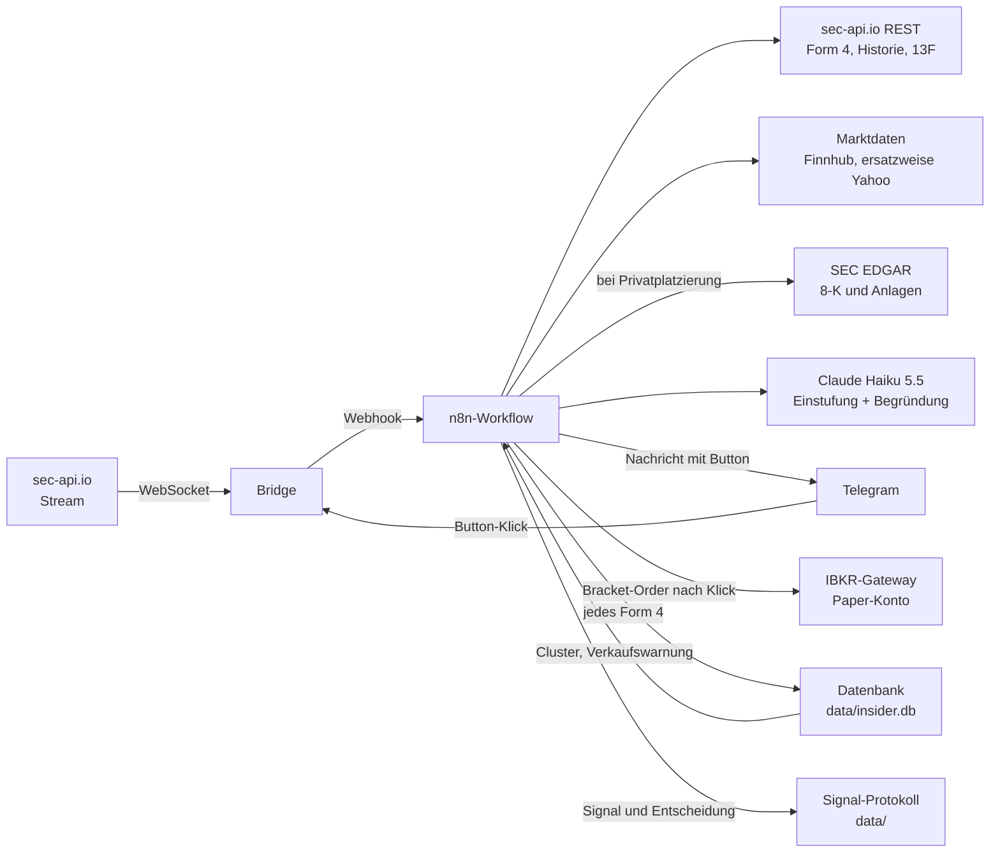

# Insider-Pipeline

Meldet Insiderkäufe aus SEC-Form-4-Filings in Echtzeit per Telegram, bewertet sie mit Claude und bereitet eine Bracket-Order für ein **Paper-Trading-Konto** bei Interactive Brokers vor. Die Order wird erst gesendet, wenn du in Telegram auf den Button tippst.

Nebenbei speichert die Pipeline jede Insider-Meldung in einer lokalen Datenbank. Daraus erkennt sie, wenn mehrere Insider desselben Unternehmens kurz nacheinander kaufen (Cluster), und sie warnt dich, wenn ein Insider wieder verkauft, dessen Kauf du gefolgt bist.

Alles läuft lokal in Docker: `docker compose up -d` startet n8n samt fertig importiertem Workflow, eine kleine Bridge und das IBKR-Gateway.

> Kein Anlageberatungswerkzeug. Die Einstufung des Modells ist eine Einschätzung auf Basis weniger Kennzahlen, und das Projekt ist ausschließlich für Paper-Trading gedacht.

## So funktioniert es



1. Die **Bridge** hält die WebSocket-Verbindung zum sec-api.io-Stream, lässt nur Form 4 durch und übergibt jedes Filing einmal an n8n.
2. Der **Workflow** lädt die Transaktionen des Filings und legt sie in der **Datenbank** ab – jedes Form 4, auch Verkäufe und kleine Käufe. Verkauft dabei ein Insider, dessen Kauf du gefolgt bist, bekommst du eine **Verkaufswarnung**.
3. Weiter geht es nur mit Offenmarktkäufen (Transaction Code `P`, Preis > 0) im Wert von mindestens `MIN_PURCHASE_VALUE_USD`, also 25.000 $, wenn du nichts anderes einstellst.
4. Für jeden solchen Kauf holt er die bisherigen Transaktionen dieses Insiders, die jüngsten 13F-Meldungen institutioneller Halter, Marktdaten (Kurs und Marktkapitalisierung von Finnhub, ersatzweise von Yahoo Finance) und aus der Datenbank die Käufe anderer Insider desselben Unternehmens (**Cluster**).
5. Deutet das Form 4 auf eine **Kapitalmaßnahme** hin – etwa Units aus einer Privatplatzierung mit Warrants –, holt der Workflow die zugehörigen SEC-Dokumente (8-K samt Anlagen) und lässt Claude die Bedingungen mit wörtlichen Zitaten auslesen. Warrant-Wert, effektiven Preis und Verwässerung rechnet er selbst (siehe [Privatplatzierungen und Warrants](#privatplatzierungen-und-warrants)).
6. Alle Kennzahlen (Volumen, Bestandsveränderung, Erfolgsquote früherer Käufe, Short Interest …) berechnet der Workflow selbst. **Claude** bekommt sie fertig vorgelegt und liefert nur die Einstufung `SCHWACH`/`MITTEL`/`STARK` mit Begründung. In der Nachricht stehen deshalb keine Zahlen, die das Modell erfunden haben könnte.
7. Du bekommst eine **Telegram-Nachricht** mit Analyse, Order-Vorschlag und zwei Buttons. Liegt der Kurs deutlich unter dem Insiderpreis, gibt es keinen Order-Vorschlag – die Order würde sofort ausgeführt und der Stop-Loss womöglich gleich danach.
8. Erst ein Tipp auf **„Order ans Paper-Konto senden“** schickt die Bracket-Order (Kauf-Limit zum Insiderpreis, Take-Profit, Stop-Loss) an IBKR. Das Ergebnis kommt als zweite Nachricht.
9. Jedes Signal und jede Entscheidung landet im **Signal-Protokoll**. Damit lässt sich später prüfen, was die Signale tatsächlich wert waren (siehe [Signal-Protokoll und Backtest](#signal-protokoll-und-backtest)).

Fällt eine Datenquelle aus (Finnhub, Yahoo, 13F, Historie, Claude, die Datenbank), kommt die Meldung trotzdem und nennt die Lücke – bei den Marktdaten auch den Grund. Bricht der Workflow ganz ab, meldet ein Error Trigger den Fehler per Telegram.

## Voraussetzungen

| Dienst | Wofür | Hinweis |
|---|---|---|
| [Docker Desktop](https://www.docker.com/) | führt alles aus | Node.js und `npx n8n` werden nicht gebraucht. Läuft auf Macs mit Apple-Chip und mit Intel |
| [sec-api.io](https://sec-api.io/pricing) | Stream, Form 4, 13F | Zum Ausprobieren genügt der kostenlose Schlüssel (100 Abrufe insgesamt, ohne Stream). Für den Dauerbetrieb braucht es den Tarif „Personal & Startups“, der die Stream-API enthält |
| [Claude Console](https://platform.claude.com/) | Claude | API-Key und etwas Prepaid-Guthaben |
| [Finnhub](https://finnhub.io/register) | Kurs, Marktkapitalisierung, Kennzahlen | Kostenloser Schlüssel für private Nutzung. Optional – ohne ihn fragt der Workflow nur Yahoo Finance, und das blockt die Abrufe meist (siehe [Marktdaten](#marktdaten)) |
| [SEC EDGAR](https://www.sec.gov/search-filings/edgar-search-assistance/accessing-edgar-data) | Vertragsdetails zu Privatplatzierungen, Aktienzahl | Kostenlos und ohne Schlüssel. Die SEC verlangt eine Kennung mit Name und E-Mail-Adresse (`SEC_USER_AGENT`) |
| [Telegram](https://telegram.org/) | Benachrichtigung | Bot über @BotFather, eigene ID über @userinfobot |
| [Interactive Brokers](https://www.interactivebrokers.eu/) | Paper-Trading | Paper-Konto aktivieren; Kontonummer beginnt mit `D` (z. B. `DU1234567`). Die Schnittstelle für Orders verlangt laut IBKR auch dafür ein vollständig eröffnetes und eingezahltes Live-Konto vom Typ „IBKR Pro“. Ohne IBKR läuft alles außer dem Order-Button |

## Einrichtung

1. **Konfiguration anlegen**

   ```bash
   cp .env.example .env
   ```

   Trage in `.env` deine Schlüssel ein. Jede Variable ist dort erklärt. Für `BRIDGE_SECRET` genügt eine beliebige lange Zufallszeichenfolge, z. B. aus `openssl rand -hex 32`.

2. **Kursdaten-Schlüssel anlegen** (kostenlos, empfohlen): Auf <https://finnhub.io/register> ein Konto anlegen. Der Schlüssel steht danach im Dashboard unter „API Key“. Trage ihn in `.env` hinter `FINNHUB_API_KEY=` ein. Ohne ihn steht in den Meldungen meist „Marktdaten nicht verfügbar“.

3. **SEC-Kennung eintragen** (empfohlen): Trage in `.env` hinter `SEC_USER_AGENT=` deinen Namen und deine E-Mail-Adresse ein, z. B. `SEC_USER_AGENT=Max Mustermann max@example.com`. Die SEC verlangt das für automatische Abrufe; die Angabe geht nur an die SEC. Ohne sie fehlen bei Privatplatzierungen die Vertragsdetails.

4. **Telegram vorbereiten:** Schreibe deinem Bot einmal `/start`. Vorher darf er dir keine Nachrichten senden.

5. **Starten**

   ```bash
   docker compose up -d
   ```

   Der erste Start lädt rund 4 GB an Images. Dabei legt ein Hilfscontainer (`n8n-init`) deine Schlüssel als verschlüsselte n8n-Credentials an, importiert den Workflow und veröffentlicht ihn.

6. **n8n öffnen:** <http://localhost:5678> (auch in Safari) – beim ersten Aufruf legst du ein lokales Admin-Konto an. Der Workflow „Insider Pipeline“ ist bereits vorhanden und steht auf „Published“.

7. **Prüfen, ob alles verbunden ist**

   ```bash
   docker compose logs bridge        # erwartet: "sec-api-Stream verbunden"
   docker compose logs ibkr-gateway  # erwartet: "Gateway running and authenticated"
   ```

8. **Datenbank vorfüllen** (empfohlen), damit Cluster-Käufe vom ersten Tag an erkannt werden:

   ```bash
   docker compose run --rm research backfill --days 30
   ```

9. **Testlauf mit einem echten Filing** (siehe nächster Abschnitt).

### Aktualisieren

Nach einem `git pull` übernimmst du eine neue Version so:

```bash
docker compose down
docker compose run --rm -e WORKFLOW_IMPORT=force n8n-init
docker compose up -d --build
```

Der zweite Befehl spielt den Workflow aus dem Repository ein, `--build` baut Bridge und Protokoll-Dienst neu. Wenige Sekunden nach dem Start arbeitet n8n mit der neuen Version. Deine Daten in `data/` und die n8n-Ausführungen bleiben erhalten. Eigene Änderungen am Workflow in der n8n-Oberfläche gehen dabei verloren – sichere sie vorher (siehe [Aufbau des Repositorys](#aufbau-des-repositorys)).

Wer von einer Version vor der Datenbank kommt: `MIN_SHARES` in der `.env` hat keine Wirkung mehr. Der Filter richtet sich jetzt nach dem Kaufwert (`MIN_PURCHASE_VALUE_USD`, siehe [Einstellungen](#einstellungen)).

## Testen

### Testlauf mit echten Daten

Statt auf den nächsten Insiderkauf im Stream zu warten, kannst du ein bereits veröffentlichtes Form 4 durch die Pipeline schicken:

```bash
# sucht den jüngsten Insiderkauf, der den Filter passieren würde
docker compose exec bridge node src/replay.js

# oder ein bestimmtes Filing
docker compose exec bridge node src/replay.js 0001234567-26-000123
```

Nach wenigen Sekunden sollte die Telegram-Nachricht eintreffen. Tippe auf den Button und kontrolliere in der IBKR-App (Paper-Modus), dass unter „Orders“ drei zusammenhängende Orders liegen. Jeden Schritt siehst du in n8n unter „Executions“.

Dieser Testlauf ruft die echten APIs auf. **Er ist der erste Lauf gegen die echten Dienste überhaupt** – siehe [Was noch nicht geprüft ist](#was-noch-nicht-geprüft-ist).

Jeder Testlauf kostet Abrufe bei sec-api.io: vier ohne Angabe (einer für die Suche), drei mit einer Accession Number. Die Dokumente zu einer Privatplatzierung kommen kostenlos direkt von der SEC und kosten keine weiteren sec-api-Abrufe. Die Nummer des zuletzt gemeldeten Signals findest du so:

```bash
grep -o '"accessionNo":"[^"]*"' data/signals.jsonl | tail -1
```

### Marktdaten prüfen, ohne sec-api-Abrufe zu verbrauchen

Ob dein Finnhub-Schlüssel funktioniert und Finnhub ein Symbol kennt, zeigt ein direkter Abruf. Er liest den Schlüssel aus der `.env`, ohne ihn anzuzeigen:

```bash
KEY=$(grep '^FINNHUB_API_KEY=' .env | cut -d= -f2-)
curl -s -H "X-Finnhub-Token: $KEY" "https://finnhub.io/api/v1/quote?symbol=AAPL"; echo
curl -s -H "X-Finnhub-Token: $KEY" "https://finnhub.io/api/v1/stock/profile2?symbol=AAPL"; echo
```

Erwartet wird beim ersten Abruf ein Kurs im Feld `c` und ein Zeitstempel in `t`, beim zweiten unter anderem `marketCapitalization` (in Millionen). `{"error":"Invalid API key"}` heißt: Schlüssel prüfen. Lauter Nullen beim Kurs oder `{}` beim Profil heißen: Finnhub kennt dieses Symbol nicht – dann springen im Workflow Yahoo bzw. die Aktienzahl der SEC ein.

### Privatplatzierung prüfen

Ob die SEC deine Kennung annimmt, zeigt ein Abruf ohne sec-api-Abruf. Er liest `SEC_USER_AGENT` aus der `.env`:

```bash
UA=$(grep '^SEC_USER_AGENT=' .env | cut -d= -f2-)
curl -s -o /dev/null -w '%{http_code}\n' -A "$UA" https://www.sec.gov/Archives/edgar/data/1468929/000149315226051238/0001493152-26-051238-index.htm
```

`200` heißt: alles in Ordnung. `403` heißt: Die Kennung fehlt oder enthält keine E-Mail-Adresse.

Danach ein Testlauf mit einem Form 4 aus einer Privatplatzierung, etwa dem Kauf bei NexGel vom 10.11.2026 (drei sec-api-Abrufe):

```bash
docker compose exec bridge node src/replay.js 0001493152-26-051920
```

Die Nachricht sollte die Zeilen „Finanzierung:“ und „Einordnung:“ enthalten. Vergleiche die Angaben mit dem verlinkten 8-K.

### Automatische Tests

Diese Tests brauchen keine Zugangsdaten und rufen keine echten APIs auf.

```bash
sh test/e2e/run.sh                          # End-to-End: echtes n8n, alle externen Dienste als Mock (ca. 6 Minuten)
node --test test/unit/                      # Logik der Code-Nodes, Filter, Marktdaten, Finanzierung (Node.js >= 22.13)
cd bridge && npm ci && npm test             # Bridge
cd research && npm test                     # Datenbank, Protokoll, SEC-Dokumente, Auswertung, Backtest (Node.js >= 22.13)
```

Der End-to-End-Test startet n8n mit genau dem Workflow aus diesem Repository und spielt 17 Szenarien durch, darunter die aus Teil 14 der ursprünglichen Anleitung: Kauf mit Analyse und Order nach Klick, Cluster-Kauf eines zweiten Insiders, Verkaufswarnung (genau einmal, und nur nach gesendeter Order), Verkauf / Preis 0 / zu kleiner Kaufwert (keine Meldung, aber in der Datenbank), wenige teure Aktien, Marktdaten von Finnhub, gedrosseltes Finnhub mit Yahoo als Ersatz, berechnete Marktkapitalisierung, Privatplatzierung mit Warrants (Bedingungen aus nachgebildeten SEC-Dokumenten, kein Order-Vorschlag bei einem Kurs weit unter dem Insiderpreis), Ausfall aller Kursquellen und von Claude, unbekannter Kontrakt, verzögert indexiertes Filing, fremde und veraltete Klicks, von IBKR abgelehnte Order, der Fehlerpfad und Webhook-Aufrufe ohne Secret. Danach wird der Protokoll-Dienst gestoppt, um einen Ausfall der Datenbank durchzuspielen, es laufen Nachladen, Auswertung und Backtest gegen die Mock-Daten, und zum Schluss startet n8n ohne Finnhub-Schlüssel neu: Dann muss alles wie bisher über Yahoo laufen.

## Datenbank, Cluster und Verkaufswarnung

Der Dienst `journal` speichert **jedes** Form 4, das über den Stream kommt, in `data/insider.db` (SQLite) – nicht nur die Käufe, die als Signal gemeldet werden, sondern auch Verkäufe, Zuteilungen, Optionsausübungen und Käufe unter dem Schwellenwert. Abgelegt wird jede einzelne Transaktion mit Aktien (Tabelle I des Formulars); Derivate wie Optionen und Warrants (Tabelle II) bleiben in der Datenbank außen vor. Für die Analyse liest der Workflow sie trotzdem (siehe [Privatplatzierungen und Warrants](#privatplatzierungen-und-warrants)).

Darauf bauen zwei Funktionen auf:

- **Cluster.** Bei jedem Signal prüft die Pipeline, ob in den `CLUSTER_DAYS` Tagen davor (Standard 14) andere Insider desselben Unternehmens am Markt gekauft haben – egal, wie groß deren Käufe waren. Die Telegram-Nachricht nennt sie in der Zeile „Cluster“, Claude bekommt sie für die Einstufung vorgelegt, und sie stehen im Signal-Protokoll. Ob Cluster-Käufe bei dir tatsächlich besser laufen als Einzelkäufe, zeigt die Auswertung (`research report`) in einem eigenen Abschnitt.

  Verbundene Meldepflichtige – etwa ein Fonds und sein Verwalter – melden denselben Kauf mitunter in getrennten Formularen. Das sieht wie ein Cluster aus, ist aber nur ein Käufer. Stimmen Stückzahl und Kaufwert exakt mit dem gemeldeten Kauf überein, kennzeichnet die Nachricht das mit ⚠️, und Claude wird darauf hingewiesen. Kauft ein anderer Insider zum selben Preis je Aktie (auf den Cent genau), stammt der Kauf meist aus derselben Platzierung des Unternehmens. Die Nachricht vermerkt das mit „gleicher Preis“, denn auch das ist keine unabhängige Bestätigung. In Auswertung und Backtest zählen beide Fälle trotzdem als Cluster.
- **Verkaufswarnung.** Verkauft ein Insider am Markt (Code `S`), dessen Kauf dir gemeldet wurde und zu dem du die Order gesendet hast, bekommst du eine Telegram-Nachricht mit Verkauf, Restbestand und dem früheren Kauf. Verkauft wird dabei nichts automatisch. Mit `SELL_ALERT_SCOPE=signals` kommt die Warnung nach jedem gemeldeten Kauf, auch ohne Order; `off` schaltet sie ab. Erwähnt das Filing einen vorab festgelegten Handelsplan (Rule 10b5-1), steht das dabei – solche Verkäufe sagen wenig aus.

Die Warnung entsteht nur aus Meldungen, die über den Stream eintreffen, während die Pipeline läuft. Was in einer Pause gemeldet wurde, holt sie nicht nach.

### Datenbank vorfüllen

Direkt nach der Einrichtung ist die Datenbank leer, und ein Cluster lässt sich noch nicht erkennen. Die Nachricht sagt das offen („Datenbank reicht erst 3 Tage zurück“). Einmalig vorfüllen:

```bash
docker compose run --rm research backfill --days 30
```

Das lädt die Insiderkäufe der letzten 30 Tage von sec-api.io nach (höchstens 365). Die Abrufe – einer je 50 Käufe – zählen gegen dein Kontingent; am Ende steht, wie viele es waren. Nachgeladen werden nur Käufe, denn mehr braucht die Cluster-Erkennung nicht. Ein zweiter Lauf legt nichts doppelt an.

### Stand ansehen und selbst auswerten

```bash
docker compose run --rm research stats
```

zeigt, wie viele Meldungen, Käufe und Verkäufe gespeichert sind und wie weit sie zurückreichen.

Die Datei `data/insider.db` lässt sich mit jedem SQLite-Programm öffnen, zum Beispiel mit [DB Browser for SQLite](https://sqlitebrowser.org/). Arbeite am besten mit einer Kopie, damit das Programm der laufenden Pipeline nicht in die Quere kommt.

| Tabelle | Inhalt |
|---|---|
| `filings` | eine Zeile je Form 4: Meldezeit, Ticker, Unternehmen, Insider, Rolle, Summe der Offenmarktkäufe und -verkäufe |
| `transactions` | jede Transaktion: Datum, Code (`P` Kauf, `S` Verkauf, `A` Zuteilung, `M` Optionsausübung, `F` Steuereinbehalt, `G` Schenkung …), Stückzahl, Preis, Bestand danach |

Ein Beispiel – bei welchen Unternehmen haben in den letzten 30 Tagen mindestens zwei Insider gekauft?

```sql
SELECT ticker, COUNT(DISTINCT insider_cik) AS insider, ROUND(SUM(purchase_value)) AS kaufwert_usd
FROM filings
WHERE purchase_value > 0 AND filed_date >= date('now', '-30 days')
GROUP BY issuer_cik
HAVING insider >= 2
ORDER BY insider DESC, kaufwert_usd DESC
LIMIT 20;
```

Die Datei wächst um knapp 1 KB je Meldung. Bei einigen hundert bis gut tausend Form 4 pro Handelstag sind das grob 100 bis 300 MB im Jahr.

## Marktdaten

Die Zeile „Markt:“ der Meldung nennt Kurs, Abweichung vom Insiderpreis, Marktkapitalisierung, Quelle und Zeitpunkt des Kurses in deiner Zeitzone:

```
Markt: Kurs 5,12 $ (−6,9 % ggü. Insiderpreis) · Marktkap. 38,20 Mio. $ · Finnhub, 14.11. 21:59
```

Die Quellen werden in dieser Reihenfolge gefragt:

1. **Finnhub** – wenn in der `.env` ein `FINNHUB_API_KEY` steht. Drei Abrufe je Meldung: Kurs (`/quote`), Unternehmensprofil mit Marktkapitalisierung (`/stock/profile2`) und Kennzahlen wie KGV und 52-Wochen-Spanne (`/stock/metric`).
2. **Yahoo Finance** – ohne Schlüssel, oder wenn Finnhub keinen Kurs liefert (Fehler, Drosselung, unbekanntes Symbol). Nur Yahoo liefert Short Interest und den Anteil institutioneller Halter; kommt der Kurs von Finnhub, fehlen diese beiden Angaben.
3. **SEC** – nur wenn ein Kurs da ist, aber keine Marktkapitalisierung. Dann holt der Workflow die Zahl der ausstehenden Aktien vom Deckblatt des jüngsten Quartals- oder Jahresberichts (`data.sec.gov`, Kennzahl `dei:EntityCommonStockSharesOutstanding`) und rechnet Kurs × Aktien. Die Nachricht kennzeichnet das: „Marktkap. ca. 38,20 Mio. $ (berechnet: Kurs × 7,5 Mio. Aktien lt. SEC, Stand 30.09.2026)“. Die Aktienzahl kann einige Monate alt sein; älter als 400 Tage wird sie nicht verwendet.

Was eine Quelle nicht liefert, bleibt leer – geschätzt wird nichts. Fallen alle Quellen aus, nennt die Zeile die Gründe: „Marktdaten nicht verfügbar (Finnhub: kein Schlüssel · Yahoo: HTTP 429)“.

Die Marktdaten halten die Meldung nur kurz auf: Jeder Abruf hat ein Zeitlimit von fünf bis sechs Sekunden, und bei einem Fehler gibt es höchstens einen Wiederholversuch nach anderthalb Sekunden. Im Normalfall sind es drei kurze Abrufe hintereinander.

### Warum Finnhub

Geprüft am 15.11.2026 auf den Seiten der Anbieter. Der Bedarf: drei Abrufe je Meldung. Bei geschätzt 30 bis 150 Meldungen pro Handelstag (Käufe ab 25.000 $; nicht gemessen) sind das 90 bis 450 Abrufe am Tag, gebündelt am Abend deutscher Zeit.

| Anbieter | Kostenloser Zugang | Passt? |
|---|---|---|
| [Finnhub](https://finnhub.io/pricing) | 60 Abrufe pro Minute (ein Tageslimit nennt die Preisseite nicht), private Nutzung erlaubt. Kurs für US-Aktien in Echtzeit, Unternehmensprofil mit Marktkapitalisierung und Kennzahlen sind [nicht kostenpflichtig](https://finnhub.io/docs/api/quote) | Ja. Short Interest und Aktionärsstruktur kosten extra |
| [Financial Modeling Prep](https://site.financialmodelingprep.com/pricing-plans) | 250 Abrufe pro Tag, nur Schlusskurse; Marktkapitalisierung nur für 87 große Titel | Nein – deckt Small Caps nicht ab |
| [Twelve Data](https://twelvedata.com/pricing) | 8 Credits pro Minute, 800 pro Tag; Fundamentaldaten kosten laut Preisseite bis zu 100 Credits je Abruf | Nein – der Kurs ginge, für die Marktkapitalisierung reichen die Credits nicht |
| [Alpha Vantage](https://www.alphavantage.co/support/) | 25 Abrufe pro Tag; Echtzeit- und 15-Minuten-Kurse nur gegen Bezahlung | Nein – zu wenig Abrufe |

Die Bedingungen ändern sich; maßgeblich sind die Seiten der Anbieter. Der Schlüssel liegt nur in deiner `.env` und in n8n als verschlüsseltes Credential. Er wird als Header gesendet und steht weder in einer Adresse noch im Workflow.

## Privatplatzierungen und Warrants

Nicht jeder Kauf mit Code `P` ist ein Kauf am offenen Markt. Zeichnet ein Insider Units aus einer Privatplatzierung, ist der Preis ausgehandelt, und oft gehören Warrants, eine geänderte Wandelanleihe oder eine geplante Fusion dazu. Ohne diese Bedingungen lässt sich der Kauf kaum einordnen.

**Wann:** Der Workflow erkennt solche Käufe am Form 4 – an Begriffen in den Fußnoten („Securities Purchase Agreement“, „private placement“, „each unit consists of …“, „purchased from the Issuer“ und ähnliche) oder an Warrants und Wandelpapieren, die in Tabelle II erworben wurden. Fußnoten und Anmerkungen gehen dafür vollständig an Claude; früher wurde jede Fußnote nach 400 Zeichen abgeschnitten. Für reine Marktkäufe ändert sich nichts.

**Woher:** Der Dienst `journal` sucht im Verzeichnis des Unternehmens bei der SEC (`data.sec.gov`) die Filings der 30 Tage vor dem Form 4: 8-Ks zu wesentlichen Verträgen, Übernahmen, Finanzverbindlichkeiten und der Ausgabe nicht registrierter Aktien (Items 1.01, 2.01, 2.03, 3.02, 3.03, 8.01), Fusionsunterlagen (425, S-4, Proxy), Prospekte und Registrierungen. Aus dem Archiv (`www.sec.gov`) lädt er das Hauptdokument und bis zu vier Anlagen: Kaufvertrag (EX-10), Warrant oder Anleihe (EX-4), Pressemitteilung (EX-99) und Fusionsvertrag (EX-2). Daraus schneidet er die passenden Items und die Abschnitte um Begriffe wie „Exchange Cap“, „exercise price“ oder „conversion price“ heraus, zusammen höchstens 30.000 Zeichen. Das kostet keinen sec-api-Abruf. Die SEC verlangt dafür eine Kennung mit E-Mail-Adresse (`SEC_USER_AGENT`).

**Auslesen und Prüfen:** Claude überträgt die Bedingungen in 25 feste Felder, darunter Preis je Unit, Ausübungspreis, Reset-Klausel, Exchange Cap, Wandlungspreis, Zweck und Zeitplan der Fusion – jede Angabe mit wörtlichem Zitat. Der Workflow übernimmt nur, was er belegen kann:

- Das Zitat steht so im genannten Dokument.
- Eine Zahl steht im Zitat.
- Ein Datum ist nicht bloß errechnet.

Verworfene Angaben stehen im Signal-Protokoll unter `financing.rejected`.

**Rechnen:** Den Rest rechnet der Workflow selbst:

- **Wert eines Warrants nach Black-Scholes:** Kurs, Ausübungspreis und Laufzeit stammen aus dem Form 4, ersatzweise aus dem Dokument. Dazu kommen der Zins aus `RISK_FREE_RATE_PCT` und drei angenommene Volatilitäten (60, 100 und 140 %). Daraus ergibt sich eine Spanne.
- **Effektiver Preis je Aktie:** der Preis je Unit abzüglich der Warrants. Zum Kauf zählen nur Warrants, die im selben Vorgang gekauft wurden (Code `P` in Tabelle II). Geänderte ältere Papiere, etwa Warrants mit gesenktem Ausübungspreis, stehen zwar auch im Form 4, gehören aber nicht dazu. Ergibt sich mehr als zwei Warrants je Aktie oder ein Preis von null oder darunter, lässt die Meldung den Wert weg und nennt den Grund.
- **Höchstmögliche Verwässerung:** neue Aktien, Warrants und Wandlung der Anleihe; im ungünstigsten Fall mit Reset auf die Untergrenze. Nennt das Dokument die Zahl der Warrants nicht, gilt die Zusammensetzung der Units aus dem Form 4. Fehlen Nennbetrag oder Wandlungspreis, zählen die Aktien aus den Wandelpapieren des Insiders laut Form 4 (Tabelle II). Papiere anderer Gläubiger kann das Form 4 nicht zeigen; die Zeile sagt dann „nur Papiere des Insiders“. Platzierung und Wandlung stehen getrennt da.
- **Geänderte Bedingungen:** Meldet das Form 4 ältere Papiere mit neuem Preis, etwa einen von 12 auf 5,50 $ gesenkten Wandlungspreis, nennt die Zeile „Finanzierung:“ das („geändert lt. Form 4“). Das liest der Workflow ohne KI direkt aus Tabelle II.

```
Finanzierung: Privatplatzierung · Units zu 5,50 $ (one share and one warrant) · Warrants zu 6,00 $ bis 10.11.2031 · Reset möglich (Untergrenze 2,00 $) · Exchange Cap 19,99 % bis zur Zustimmung der HV · Quelle: 8-K vom 12.11.2026
Einordnung: Warrant ca. 1,70–3,37 $ wert (Black-Scholes, Volatilität 60–140 %) · effektiv ca. 2,13–3,80 $ je Aktie · Verwässerung bis ca. 33,3 %
```

(Beispiel mit erfundenen Vertragsdaten.) Fehlt etwas, sagt die Zeile warum, etwa „Vertragsdetails nicht ermittelt: Dokumente nicht abgerufen: SEC_USER_AGENT enthält keine E-Mail-Adresse“. Bei einer Privatplatzierung kommt die Meldung geschätzt 5 bis 15 Sekunden später; die Auslese kostet weniger als einen Cent.

**Grenzen:**

- Black-Scholes mit angenommener Volatilität ist für Warrants mit Reset-Klausel nur eine grobe Näherung.
- Was das Unternehmen noch nicht veröffentlicht hat, kann keine Meldung kennen. Ein 8-K darf bis zu vier Geschäftstage nach dem Vertrag kommen, ein Form 4 schon nach zwei. Nachträge für später eingereichte Dokumente gibt es noch nicht.

### Kein Order-Vorschlag bei Kurs weit unter dem Insiderpreis

Limit, Stop-Loss und Take-Profit hängen am Insiderpreis. Liegt der aktuelle Kurs deutlich darunter, würde die Kauforder sofort zum Marktpreis ausgeführt, und ein Stop-Loss über dem Kurs löste gleich danach aus. Liegt der Kurs mehr als `ORDER_MAX_PRICE_GAP_PCT` Prozent (Standard 5, höchstens `STOP_LOSS_PCT`) unter dem Insiderpreis, schlägt die Nachricht deshalb keine Order vor und nennt den Grund. Ist kein Kurs bekannt, bleibt der Vorschlag, mit dem Hinweis, den Kurs vor dem Senden selbst zu prüfen. Geprüft wird beim Erstellen der Nachricht, nicht beim Tippen auf den Button.

## Signal-Protokoll und Backtest

> **Bekanntes Problem:** Auswertung und Backtest (`research report`, `research backtest`) holen ihre Tageskurse von Yahoos Chart-Schnittstelle. Sie ist vom selben Block betroffen wie die Marktdaten (HTTP 429, gemessen am 14.11.2026). Bis das behoben ist, können beide Befehle scheitern oder für viele Titel „keine Kursdaten“ melden. Die Telegram-Meldungen sind davon nicht betroffen.

Ob die Signale etwas taugen, zeigt erst die Messung. Dafür gibt es zwei Werkzeuge, die dieselbe Rechenlogik verwenden: das Protokoll für die Signale, die du ab jetzt bekommst, und den Backtest für die Vergangenheit.

### Signal-Protokoll

Der Dienst `journal` schreibt jede Telegram-Meldung mit allen Kennzahlen, der Einstufung des Modells und dem Order-Vorschlag nach `data/signals.jsonl`, und jede Entscheidung (Order gesendet, abgelehnt, verworfen) sowie jede Verkaufswarnung nach `data/events.jsonl`. Beide Dateien werden nur erweitert, nie überschrieben.

```bash
docker compose run --rm research report
```

Die Auswertung holt aktuelle Kurse und zeigt, wie sich die gemeldeten Aktien seit dem Signal gegenüber dem Markt (SPY) entwickelt haben – nach 5, 20 und 60 Handelstagen, insgesamt, je Einstufung (STARK/MITTEL/SCHWACH), je Entscheidung und getrennt nach Cluster- und Einzelkäufen. Gerechnet wird mit Kauf zum Eröffnungskurs am ersten Handelstag nach dem Filing. Das Ergebnis liegt zusätzlich in `data/signals-report.md` und als Excel-taugliche Tabelle in `data/signals-report.csv`.

Aussagekräftig wird das erst mit der Zeit: Eine Haltedauer zählt erst, wenn sie abgelaufen ist, und Unterschiede zwischen den Einstufungen lassen sich erst ab etwa 100 Signalen je Gruppe von Zufall trennen.

### Backtest

```bash
docker compose run --rm research backtest --from 2024-01-01 --to 2025-06-30
```

Der Backtest lädt alle Insiderkäufe des Zeitraums von sec-api.io, wendet den Kauf-Filter des Workflows an und rechnet mit historischen Tageskursen von Yahoo nach. Der Bericht (`data/backtest/report.md`, Einzelwerte in `data/backtest/trades.csv`) beantwortet drei Fragen:

1. **Was ist das Signal wert?** Rendite und Überrendite gegenüber dem Markt nach 5, 20, 60 und 120 Handelstagen.
2. **Welche Order-Regel ist besser?** Die jetzige Regel des Workflows (Limit zum Insiderpreis mit Stop-Loss und Take-Profit) im Vergleich zu einem Kauf zur Eröffnung mit und ohne Stop-Loss/Take-Profit – jeweils mit Ausführungsquote und Rendite nach Kosten.
3. **Welche Signale sind besser?** Überrendite nach Rolle des Insiders, Kaufvolumen, Veränderung des Bestands, Cluster-Käufen, Routine- oder Gelegenheitskäufern, Handelbarkeit und Kursverlauf davor.

Wichtige Optionen (alle mit `docker compose run --rm research help`):

| Option | Standard | Bedeutung |
|---|---|---|
| `--from`, `--to` | letzte zwei Jahre | Zeitraum der Filings |
| `--min-value` | Wert aus `.env` | Mindest-Kaufwert in US-Dollar, zum Durchspielen anderer Schwellen |
| `--stop-loss`, `--take-profit` | Werte aus `.env` | zum Durchspielen anderer Abstände |
| `--max-hold` | `60` | spätester Ausstieg in Handelstagen |
| `--cost-bps` | `10` | Kosten je Kauf und je Verkauf in Basispunkten |
| `--lookback-years` | `3` | Vorlauf, um Routinekäufer zu erkennen; `0` schaltet das ab |
| `--cluster-days` | Wert aus `.env` | Zeitfenster für Cluster-Käufe in Tagen |

Der erste Lauf braucht Geduld und Kontingent: Mit dem Vorlauf werden mehrere Jahre Insiderkäufe und Kurse für alle betroffenen Titel geladen, und die Abrufe zählen gegen dein Kontingent bei sec-api.io. Fang deshalb klein an, etwa mit `--from 2025-01-01 --to 2025-03-31 --lookback-years 0`. Alles Geladene liegt danach in `data/cache/`; ein zweiter Lauf mit anderen Parametern rechnet nur noch.

Was der Backtest nicht kann, steht am Ende jedes Berichts. Am wichtigsten: Unternehmen, die inzwischen von der Börse verschwunden sind, fehlen bei Yahoo – die Ergebnisse fallen dadurch zu gut aus. Und wer viele Merkmale durchprobiert, findet immer eine Gruppe, die zufällig gut aussieht; ein Merkmal verdient erst Vertrauen, wenn es sich in einem zweiten, getrennten Zeitraum bestätigt.

Unter Linux muss der Ordner `data/` dem Benutzer mit der ID 1000 gehören, sonst meldet `journal` beim Start, dass er nicht schreiben kann: `sudo chown -R 1000:1000 data`.

## Einstellungen

Alle Einstellungen stehen in `.env`. Nach einer Änderung: `docker compose up -d`.

| Variable | Standard | Bedeutung |
|---|---|---|
| `MIN_PURCHASE_VALUE_USD` | `25000` | Nur Käufe ab diesem Gesamtwert werden gemeldet (Aktien × Preis, alle Teilkäufe einer Meldung zusammen). Gespeichert wird jede Meldung |
| `CLUSTER_DAYS` | `14` | So viele Tage zurück zählen Käufe anderer Insider desselben Unternehmens als Cluster |
| `SELL_ALERT_SCOPE` | `orders` | Verkaufswarnung: `orders` nur nach gesendeter Order, `signals` nach jedem gemeldeten Kauf, `off` nie |
| `SELL_ALERT_LOOKBACK_DAYS` | `365` | So viele Tage nach dem gemeldeten Kauf wird noch gewarnt |
| `ORDER_BUDGET_USD` | `5000` | Ordergröße: Stückzahl = Budget / Limitpreis |
| `ORDER_QUANTITY` | leer | Feste Stückzahl; hat Vorrang vor dem Budget |
| `STOP_LOSS_PCT` | `8` | Abstand des Stop-Loss zum Limitpreis in Prozent |
| `TAKE_PROFIT_PCT` | `15` | Abstand des Take-Profit zum Limitpreis in Prozent |
| `ORDER_MAX_PRICE_GAP_PCT` | `5` | Kein Order-Vorschlag, wenn der Kurs mehr als so viel Prozent unter dem Insiderpreis liegt (höchstens `STOP_LOSS_PCT`) |
| `ORDER_BUTTON_MAX_AGE_HOURS` | `24` | Danach ist der Order-Button wirkungslos |
| `ANTHROPIC_MODEL` | `claude-haiku-5-5` | Modell für die Einstufung |
| `FINNHUB_API_KEY` | leer | Kostenloser Schlüssel für Kursdaten. Leer: Der Workflow fragt nur Yahoo Finance |
| `SEC_USER_AGENT` | leer | Kennung für Abrufe bei der SEC: Name und E-Mail-Adresse, z. B. `Max Mustermann max@example.com`. Ohne E-Mail gibt die SEC keine Dokumente heraus – dann fehlen die Vertragsdetails zu Privatplatzierungen. Leer: `insider-pipeline/1.0` |
| `RISK_FREE_RATE_PCT` | `4` | Zins für den Wert von Warrants (Black-Scholes), in Prozent |
| `COMPOSE_PROFILES` | `ibkr` | Leer lassen, wenn du ein eigenes IBKR-Gateway betreibst |

Den Prompt findest du in n8n im Node **Build_Prompt**, den Aufbau der Nachricht in **Build_Message**. Nach Änderungen in der Oberfläche auf „Publish“ klicken. `docker compose up -d` überschreibt einen vorhandenen Workflow nicht; die Version aus dem Repository spielst du wieder ein wie unter [Aktualisieren](#aktualisieren) beschrieben.

## Abweichungen von der ursprünglichen Anleitung

Die Anleitung, nach der dieses Projekt entstanden ist, hätte an mehreren Stellen nicht funktioniert. Die Zielarchitektur ist geblieben; geändert wurde Folgendes:

| Anleitung | Problem | Umsetzung |
|---|---|---|
| „WebSocket Trigger“ in n8n | Den Node gibt es in n8n nicht | Bridge-Dienst (`bridge/`) leitet den Stream an einen n8n-Webhook weiter, mit Reconnect und Deduplizierung |
| Filter auf `transactions[0].transactionCode` der Stream-Nachricht | Der Stream liefert nur Metadaten, keine Transaktionen | Transaktionen kommen aus der Insider-Trading-API; alle Kauf-Lose eines Filings werden summiert |
| Schwelle „mehr als 1.000 Aktien“ | 1.000 Aktien können 500 $ oder 900.000 $ wert sein | Schwelle nach Kaufwert (`MIN_PURCHASE_VALUE_USD`) |
| Historie über `ticker` und `reportingOwnerName` | Die Query-API liefert keine Transaktionsdaten | Insider-Trading-API, gesucht über die CIK von Emittent und Insider |
| Yahoo `v7/finance/quote` mit User-Agent | Verlangt inzwischen Cookie und Crumb; Short Interest ist dort nicht enthalten | Zuerst Finnhub (offizielle API, kostenloser Schlüssel). Yahoo bleibt als Ersatz: Cookie → Crumb → `quoteSummary`. Die Schnittstelle ist inoffiziell und blockt Abrufe inzwischen meist |
| `claude-3-5-haiku-20241022`, `max_tokens: 500`, Antwort aus `content[0].text` | Das Modell wurde im Februar 2026 abgeschaltet. Beim Nachfolger zählen Denk-Tokens mit und der Text steht nicht zwingend im ersten Block | `claude-haiku-5-5`, `max_tokens: 4000`, strukturierte JSON-Ausgabe, Auswertung nach Blocktyp |
| Rohdaten per `{{$node[...].json}}` in den Prompt, Modell rechnet Kennzahlen | Ergibt `[object Object]`; gerechnete Zahlen eines Modells sind nicht verlässlich | Kennzahlen berechnet der Workflow, das Modell stuft nur ein |
| `docker run ghcr.io/extt/ibkr-client-portal-api` | Das Image ist nicht öffentlich abrufbar | [IBeam](https://github.com/Voyz/ibeam) 0.6.0: enthält das Gateway und meldet sich selbst an (auch nach Ablauf der Sitzung) |
| `"conid": <Symbol>` | IBKR erwartet die numerische Kontrakt-ID | Nachschlagen über `/trsrv/stocks`, nur US-Listing |
| `"transmit": false` als Sicherung | Das Feld gehört zur TWS-API. Die Client-Portal-REST-API kennt es nicht – die Order wäre sofort aktiv geworden | Die Order wird erst nach Klick auf den Telegram-Button gesendet |
| „Bracket-Order“ mit einer einzelnen Kauforder | Stop-Loss und Take-Profit fehlten | Drei verknüpfte Orders (`cOID`/`parentId`) |
| Feste Stückzahl 100 | 100 Aktien können 200 $ oder 90.000 $ sein | Budget je Signal; feste Stückzahl bleibt über `ORDER_QUANTITY` möglich |
| Fehlertext aus `$json.error.message` | Das Feld heißt `$json.execution.error.message`; Unterstriche in Node-Namen brechen Telegrams Markdown | Korrigiert, als HTML mit Maskierung gesendet |

Zusätzlich eingebaut: Der Workflow sendet nur an Konten, deren Nummer wie ein Paper-Konto aussieht (beginnt mit `D`). Die Webhooks verlangen ein gemeinsames Geheimnis (`BRIDGE_SECRET`), und n8n sowie das Gateway sind nur von deinem Rechner aus erreichbar.

Falls du den Entwurf lieber in der IBKR-App statt in Telegram bestätigen möchtest: Das Order-Ticket der Client-Portal-API hat ein Feld `deactivated`, das eine Order gespeichert, aber inaktiv anlegen soll. Das ließ sich hier nicht prüfen und ist deshalb nicht eingebaut.

## Was noch nicht geprüft ist

Aus der Entwicklungsumgebung waren sec-api.io, Yahoo Finance, Telegram und IBKR nicht erreichbar. Geprüft ist der Workflow deshalb gegen Nachbildungen dieser Dienste – in einem echten n8n 2.47.3, aber nicht gegen die echten APIs. Die Formate stammen aus den offiziellen sec-api-Clientbibliotheken und aus verbreiteten Open-Source-Clients (yfinance, ibind). Achte beim ersten Testlauf besonders auf:

- **13F-Abfrage:** `holdings.ticker:<TICKER>` am Endpunkt `/form-13f/holdings`. Bleibt die Zeile „13F-Halter“ leer, stimmt vermutlich die Abfragesyntax nicht.
- **Yahoo Finance blockt die Abrufe.** Gemessen am 14.11.2026 von einem Anschluss in Deutschland, mit derselben Kennung wie der Workflow: `fc.yahoo.com` liefert das Cookie (HTTP 404 mit `Set-Cookie`, keine Einwilligungsseite), aber schon der Crumb-Abruf (`/v1/test/getcrumb`) und auch `/v8/finance/chart` antworten mit HTTP 429 „Too Many Requests“ – nach nur wenigen Anfragen, vermutlich eine Bot-Erkennung. Yahoo ist deshalb nur noch Ersatzquelle.
- **Finnhub mit echtem Schlüssel:** Antwortformate und Bedingungen stammen aus der offiziellen Dokumentation (Stand 15.11.2026). Getestet ist der Abruf nur gegen eine Nachbildung. Offen ist vor allem, wie vollständig Finnhub sehr kleine und außerbörslich gehandelte Titel abdeckt. Der Abschnitt [Marktdaten prüfen](#marktdaten-prüfen-ohne-sec-api-abrufe-zu-verbrauchen) zeigt, wie du das für ein Symbol ohne sec-api-Abrufe nachsiehst.
- **Aktienzahl von der SEC:** Das Antwortformat ist gegen die echte Schnittstelle geprüft (15.11.2026), der Abruf aus n8n nur gegen eine Nachbildung. Bei Unternehmen mit mehreren Aktienklassen fehlt die Angabe häufig; dann bleibt die Marktkapitalisierung leer. Bei ausländischen Emittenten (20-F, 40-F) wird sie bewusst nicht berechnet.
- **SEC-Dokumente zu Privatplatzierungen:** Das Verzeichnis der Filings (`data.sec.gov/submissions`) ist gegen die echte Schnittstelle geprüft (15.11.2026, NexGel: 8-K vom 12.11. mit den Items 1.01, 2.03, 3.02, 8.01 und 9.01). Filing-Index und Dokumente von `www.sec.gov` waren aus der Entwicklungsumgebung nicht abrufbar, weil die SEC dafür eine Kontaktadresse verlangt. Getestet ist das Auslesen gegen nachgebildete EDGAR-Seiten im üblichen Format. Prüfe beim ersten Fall die Zeile „Finanzierung:“ gegen das verlinkte 8-K.
- **Auslese durch Claude:** Jede übernommene Angabe ist durch ein Zitat aus dem Dokument belegt. Fehlen kann trotzdem etwas, das im Dokument steht. Dann taucht es nicht in der Zeile auf, und Claude nennt es als Datenlücke.
- **IBKR-Order:** Aufbau der Bracket-Order und Bestätigung der Rückfragen (`/iserver/reply`). Bitte die drei Orders nach dem ersten Klick in der App kontrollieren.
- **IBeam-Login:** Die automatische Anmeldung ist für Paper-Zugangsdaten ohne Zwei-Faktor-Abfrage gedacht.
- **Indexierung bei sec-api:** Der Workflow fragt ein neues Filing bis zu viermal im Abstand von 20 Sekunden ab. Dauert die Indexierung regelmäßig länger, bekommst du Fehlermeldungen „nicht in der Insider-Trading-API gefunden“.
- **Datenbank unter Last:** Getestet sind einzelne Meldungen, nicht das Aufkommen eines echten Handelstags mit mehreren hundert bis über tausend Form 4. Ob alles ankommt, zeigt `docker compose run --rm research stats` nach dem ersten Tag.
- **Cluster und Verkaufswarnung:** Beide ordnen Meldungen über die Kennnummern (CIK) von Unternehmen und Insider zu, wie sec-api.io sie liefert. Bei gemeinsamen Meldungen mehrerer Personen (etwa ein Fonds und dessen Verwalter) ist ungeprüft, welche Person sec-api.io nennt.
- **Auswertung und Backtest:** Historische Kurse kommen von Yahoos Chart-Schnittstelle (`/v8/finance/chart`), die Insiderkäufe aus einer Zeitraum-Abfrage (`filedAt:[… TO …]`) der Insider-Trading-API. Beides ist nur gegen Nachbildungen getestet. Prüfe beim ersten Backtest ein, zwei Zeilen aus `trades.csv` von Hand gegen ein Kursdiagramm. Die Chart-Schnittstelle antwortete am 14.11.2026 mit HTTP 429 (siehe oben) – das ist ein bekanntes, noch offenes Problem.

## Fehlerbehebung

| Symptom | Ursache und Lösung |
|---|---|
| Keine Nachrichten | EDGAR nimmt Filings Mo–Fr von 6 bis 22 Uhr US-Ostküstenzeit an, und nur wenige Form 4 sind Käufe über dem Schwellenwert. Mit `docker compose exec bridge node src/replay.js` prüfst du die Pipeline sofort |
| Bridge-Log: „Verbindung abgelehnt (HTTP 401/403)“ | `SEC_API_KEY` falsch oder der Tarif enthält die Stream-API nicht |
| Bridge-Log: „konnte nicht an n8n übergeben werden: HTTP 404“ | Workflow nicht veröffentlicht: in n8n auf „Publish“ klicken |
| Bridge-Log: HTTP 403 bei der Übergabe | `BRIDGE_SECRET` geändert: `docker compose up -d` ausführen, damit n8n den neuen Wert bekommt |
| „KI-Analyse nicht verfügbar“ | Anthropic-Guthaben aufgebraucht oder Key falsch; der Fehlertext steht in der Nachricht |
| „Marktdaten nicht verfügbar (Finnhub: kein Schlüssel · Yahoo: HTTP 429)“ | Yahoo blockt die Abrufe, und es ist kein Finnhub-Schlüssel hinterlegt. Kostenlosen Schlüssel auf <https://finnhub.io/register> anlegen, in `.env` als `FINNHUB_API_KEY` eintragen, dann `docker compose up -d` |
| „Finnhub: HTTP 401“ in der Zeile „Markt:“ | Der Schlüssel ist falsch oder unvollständig eingetragen. Mit dem Abruf unter [Marktdaten prüfen](#marktdaten-prüfen-ohne-sec-api-abrufe-zu-verbrauchen) kontrollieren |
| „Finnhub: HTTP 429“ | Mehr als 60 Abrufe in einer Minute. Für diese Meldung springt Yahoo ein; die nächste klappt wieder |
| „Finnhub: kein Kurs für …“ | Finnhub kennt das Symbol nicht (häufig bei außerbörslich gehandelten Titeln). Yahoo wird als Ersatz gefragt |
| „Marktkap. n. v. (…)“ | Weder die Kursquelle noch die SEC nennen eine verwertbare Zahl; der Grund steht in der Klammer. Der Kurs stimmt trotzdem |
| Nach dem Eintragen des Schlüssels steht weiter „Yahoo“ oder „kein Schlüssel“ in der Zeile | `docker compose up -d` ausführen, damit n8n den Schlüssel bekommt. Fehlen Quelle und Uhrzeit in der Zeile ganz, läuft noch der alte Workflow – siehe [Aktualisieren](#aktualisieren) |
| „Vertragsdetails nicht ermittelt: Dokumente nicht abgerufen: SEC_USER_AGENT enthält keine E-Mail-Adresse …“ | In `.env` hinter `SEC_USER_AGENT=` Namen und E-Mail-Adresse eintragen, dann `docker compose up -d` |
| „Vertragsdetails nicht ermittelt: … HTTP 403“ | Die SEC lehnt die Kennung ab. Namen und eine gültige E-Mail-Adresse eintragen; mit dem Abruf unter [Privatplatzierung prüfen](#privatplatzierung-prüfen) kontrollieren |
| „Vertragsdetails nicht ermittelt: KI: …“ | Claude konnte die Vertragsdokumente nicht auslesen; dahinter steht der Grund, den die API nennt. Der Rest der Meldung stimmt, und der Link zur Quelle führt zum Dokument. Tritt das wiederholt auf, den Text aus der Meldung melden |
| „Vertragsdetails nicht ermittelt: kein passendes Filing zwischen …“ | Das Unternehmen hat (noch) kein 8-K oder ähnliches Dokument zur Maßnahme eingereicht. Ein 8-K darf bis zu vier Geschäftstage nach dem Vertrag kommen |
| „Kurs … liegt … unter dem Insiderpreis … – kein Order-Vorschlag“ | Absicht: Die Order würde sofort ausgeführt, der Stop-Loss womöglich gleich danach. Die Grenze stellt `ORDER_MAX_PRICE_GAP_PCT` ein (siehe [Kein Order-Vorschlag …](#kein-order-vorschlag-bei-kurs-weit-unter-dem-insiderpreis)) |
| Bei einer Privatplatzierung fehlt die Zeile „Finanzierung:“ | n8n oder der Dienst `journal` arbeiten noch mit der alten Version – siehe [Aktualisieren](#aktualisieren), mit `--build` |
| „IBKR-Gateway nicht erreichbar oder nicht eingeloggt“ | `docker compose logs ibkr-gateway` prüfen. Nach zu vielen Fehlanmeldungen beendet sich IBeam absichtlich: Zugangsdaten korrigieren, dann `docker compose up -d` |
| IBKR antwortet mit „Access Denied“ | Das Gateway lässt die Adresse nicht zu: `ibkr/conf.yaml` muss eingebunden sein (Abschnitt `ips.allow`) |
| Telegram-Button reagiert nicht | Für den Bot ist ein Webhook gesetzt oder ein zweites Programm fragt denselben Bot ab; das Bridge-Log nennt den Grund |
| Keine Telegram-Nachricht, auch kein Fehler | Dem Bot noch nicht `/start` geschrieben oder `TELEGRAM_CHAT_ID` falsch; in n8n unter „Executions“ steht der Fehler des Telegram-Nodes |
| n8n startet nicht, `n8n-init` meldet fehlende Werte | In `.env` fehlt einer der genannten Schlüssel |
| „FEHLER IM WORKFLOW … beim Node Signal_Log“ (oder Order_Log) | Der Dienst `journal` läuft nicht oder darf nicht nach `data/` schreiben: `docker compose logs journal`. Die Telegram-Meldung selbst kommt trotzdem an |
| „Cluster: nicht geprüft – Datenbank nicht erreichbar“ | Dieselbe Ursache: Der Dienst `journal` läuft nicht. Solange er steht, wird nichts gespeichert und es gibt keine Verkaufswarnungen |
| „Datenbank reicht erst … Tage zurück“ | Kein Fehler: Die Datenbank ist jünger als das Cluster-Zeitfenster. `docker compose run --rm research backfill --days 30` füllt sie vor |
| Nach einem Update fehlt die Zeile „Cluster“ in der Nachricht | n8n arbeitet noch mit dem alten Workflow – siehe [Aktualisieren](#aktualisieren) |
| Keine Verkaufswarnung, obwohl ein Insider verkauft hat | Gewarnt wird nur nach einer gesendeten Order (`SELL_ALERT_SCOPE`), nur für Offenmarktverkäufe (Code `S`) derselben Person und nur, wenn die Meldung bei laufender Pipeline eintraf |

Nützliche Befehle:

```bash
docker compose ps                 # Zustand aller Dienste
docker compose logs -f bridge     # eingehende Filings und Klicks
docker compose down               # stoppen (Daten bleiben im Volume n8n_data)
```

## Kosten

| Posten | Kosten |
|---|---|
| sec-api.io „Personal & Startups“ | 55 USD/Monat (49 USD bei jährlicher Zahlung); zum Ausprobieren 100 Abrufe kostenlos – ein Testlauf mit `replay.js` braucht etwa vier |
| Anthropic, Claude Haiku 5.5 | 0,10 USD je Mio. Eingabe- und 0,50 USD je Mio. Ausgabe-Tokens; pro Analyse unter 0,001 USD, bei 500 Analysen im Monat unter 0,50 USD. Bei einer Privatplatzierung kommt die Auslese der Vertragsdokumente dazu, unter 0,01 USD |
| Finnhub (Kursdaten) | kostenlos für private Nutzung, 60 Abrufe pro Minute |
| SEC (Aktienzahl, Dokumente zu Privatplatzierungen), Yahoo Finance, Telegram, n8n, IBKR-Paper-Konto | kostenlos (für das Paper-Konto muss das IBKR-Live-Konto eingezahlt sein) |

Die Preise ändern sich; maßgeblich sind die Preisseiten der Anbieter.

## Aufbau des Repositorys

```
docker-compose.yml          alle Dienste
.env.example                Vorlage für die Konfiguration
n8n/init.sh                 legt Credentials an, importiert und veröffentlicht den Workflow
n8n/workflows/              der n8n-Workflow (Quelle der Wahrheit)
bridge/                     sec-api-Stream und Telegram-Klicks -> n8n-Webhooks, replay.js für Testläufe
research/                   Datenbank, Signal-Protokoll und SEC-Dokumente (Dienst journal), Nachladen, Auswertung und Backtest
data/                       Datenbank, Protokoll, Berichte und Cache (bleibt lokal, nicht im Git)
ibkr/conf.yaml              Gateway-Konfiguration (Zugriff aus dem Docker-Netz)
test/e2e/                   End-to-End-Test mit Mock aller externen Dienste
test/unit/                  Tests der Workflow-Logik
```

Geänderten Workflow aus n8n zurück ins Repository holen:

```bash
docker compose exec n8n n8n export:workflow --id=insiderPipeline1 --pretty --output=/tmp/workflow.json
docker compose cp n8n:/tmp/workflow.json n8n/workflows/insider-pipeline.json
```
